# ASOBI: análise da solução e divisão em serviços

Este documento começa pelo problema que a loja resolve e vai até os serviços que formam o sistema,
nesta ordem: **necessidade → requisito → funcionalidade → processo → domínio → serviço → dados → contratos → fluxos**.
Cada decisão vem com o motivo.

Como rodar e colocar no ar cada serviço está no documento de cada um, aqui em `docs/`: [backend](backend.md),
[shipping-service](shipping-service.md), [admin-auth-service](admin-auth-service.md),
[two-factor-service](two-factor-service.md) e [notification-service](notification-service.md).

## Resumo em poucas palavras

- A **loja** (Next.js) é o site que o cliente vê. Ela não guarda nada: pede tudo ao backend.
- O **backend** (Java + Spring Boot) é o centro: cuida de jogos, pedidos, estoque, avaliações, textos do
  site e do painel do lojista.
- Quatro **serviços menores** fazem tarefas separadas, cada um com o seu motivo:
  - `shipping-service`: calcula o frete com o Melhor Envio;
  - `admin-auth-service`: guarda a lista de admins e confere o login com Google;
  - `two-factor-service`: manda e confere o código por e-mail do login do painel;
  - `notification-service`: manda os e-mails de "avise-me" (promoção, voltou ao estoque, está acabando).
- Tudo usa planos gratuitos: Cloudflare (loja), Google Cloud Run (Java) e Supabase (banco e fotos).
- Pedido, estoque e pagamento ficaram **juntos no backend** de propósito: eles precisam ser salvos ao
  mesmo tempo, e separar isso daria muito trabalho sem ganho para uma loja pequena.

## Palavras usadas neste documento

| Palavra | O que quer dizer aqui |
|---|---|
| **Serviço / microsserviço** | Um programa separado, com o próprio endereço, que faz uma tarefa só |
| **API / REST / JSON** | O jeito como os programas conversam: um chama um endereço (`GET /api/products`) e recebe os dados em JSON |
| **Domínio** | Um "assunto" do negócio: catálogo, pedidos, avaliações etc. |
| **Webhook** | Quando um sistema de fora (o Mercado Pago) chama o nosso para avisar que algo mudou |
| **Transação** | Um grupo de gravações no banco que acontece inteiro ou não acontece (se uma falhar, todas são desfeitas) |
| **Lock (trava)** | Enquanto um pedido mexe no estoque de um jogo, outro pedido espera, para os dois não venderem a mesma unidade |
| **Idempotente** | Pode repetir a mesma chamada várias vezes que o resultado é o mesmo (ex.: não baixa o estoque duas vezes) |
| **Snapshot (cópia)** | Uma cópia do dado guardada no momento da compra (ex.: o preço que o cliente pagou), que não muda depois |
| **Cache** | Guardar uma resposta por um tempo para não perguntar de novo toda hora |
| **Desliga sozinho (escala a zero)** | O Cloud Run desliga o serviço quando ninguém usa e liga de novo no próximo acesso; por isso o custo fica perto de zero |
| **`X-Api-Key`** | Uma senha que vai em toda chamada entre o backend e os serviços menores, para ninguém de fora usar |
| **Esquema (schema)** | Uma "pasta" dentro do banco. Cada serviço tem a sua e não enxerga a dos outros |

---

## 1. Contexto e intervenção

**Problema.** Uma pequena empresa (o lojista) quer vender jogos de tabuleiro infantis pela internet.
Ela não tem equipe técnica, o orçamento de infraestrutura é praticamente zero (bem abaixo de R$ 110/mês) e o
público final envolve crianças, o que exige cuidado extra com conteúdo e dados (LGPD, art. 14).

**Intervenção definida.** Um e-commerce próprio, a **ASOBI**, com:

- loja virtual pensada para pais escolherem jogos pela idade da criança;
- checkout com pagamento terceirizado (Mercado Pago), sem guardar dados de cartão;
- **painel administrativo** que dá ao lojista controle total do site sem depender de programador;
- somente **serviços gerenciados em tier gratuito** (Cloudflare Workers, Google Cloud Run, Supabase), sem
  servidor próprio para manter.

---

## 2. Necessidades

| ID | Necessidade | Quem sente |
|---|---|---|
| N1 | Vender pela internet recebendo por Pix, cartão e boleto, com segurança | Lojista / cliente |
| N2 | Encontrar rápido jogos adequados à idade e ao perfil da criança | Cliente (pais) |
| N3 | Operar a loja por conta própria no dia a dia (produtos, preços, promoções, novidades, textos) | Lojista |
| N4 | Custo mensal de infraestrutura próximo de zero | Lojista |
| N5 | Proteger o público infantil: nada publicado sem moderação e dados mínimos | Lojista / famílias |
| N6 | Saber o custo e o prazo da entrega antes de pagar, e poder desligar isso | Cliente / Lojista |
| N7 | Não vender o que não tem em estoque e acompanhar cada pedido até o envio | Lojista |
| N8 | Acesso administrativo seguro e que possa ser delegado a outras pessoas | Lojista |

---

## 3. Requisitos

### Funcionais

| ID | Requisito | Necessidades |
|---|---|---|
| RF01 | Listar o catálogo filtrando por faixa etária e por estilo (cooperativo) | N2 |
| RF02 | Exibir a ficha do produto: fotos, descrição, idade, nº de jogadores, preço/promoção, habilidade estimulada | N2 |
| RF03 | Manter um carrinho de compras | N1 |
| RF04 | Fechar o pedido sem cadastro, com preço e estoque calculados no servidor | N1, N7 |
| RF05 | Cobrar via Mercado Pago Checkout Pro e confirmar o pagamento por webhook assinado | N1 |
| RF06 | Permitir ao cliente acompanhar o status do pedido | N7 |
| RF07 | Cotar o frete por CEP, com liga/desliga no painel e frete grátis acima de um valor | N6, N3 |
| RF08 | Receber avaliações de clientes, visíveis somente após aprovação do admin | N5 |
| RF09 | CRUD de produtos e faixas etárias, controle de estoque e de promoção | N3, N7 |
| RF10 | Definir por quanto tempo um produto fica em "Novidades" e ver quanto falta | N3 |
| RF11 | Editar a página "Sobre" pelo painel | N3 |
| RF12 | Adicionar e remover e-mails de administradores pelo painel | N8 |
| RF13 | Gerenciar pedidos: marcar como pago (modo manual), enviado ou cancelado | N7 |
| RF14 | Entrar no painel com conta Google autorizada pela lista de admins | N8 |
| RF15 | Dashboard com faturamento, pedidos e visualizações por produto | N3 |
| RF16 | Editar pelo painel os textos das políticas e os dados de contato/rodapé (telefone, e-mail, redes, razão social e CNPJ) | N3 |

### Não funcionais

| ID | Requisito | Necessidades |
|---|---|---|
| RNF01 | Custo ≈ R$ 0/mês usando tiers gratuitos; serviços escalam a zero | N4 |
| RNF02 | Apenas serviços gerenciados (nada de VPS ou servidor próprio) | N3, N4 |
| RNF03 | Backend em Java 17 / Spring Boot (exigência acadêmica) | — |
| RNF04 | Nunca armazenar dados de cartão (pagamento 100% no Mercado Pago) | N1 |
| RNF05 | LGPD: coletar só dados do responsável adulto, nada da criança | N5 |
| RNF06 | Falha de API externa (frete) não pode derrubar a loja nem o checkout | N1, N6 |
| RNF07 | Integrações externas substituíveis sem mexer no núcleo da loja | N3, N6 |
| RNF08 | Rotas públicas em português (SEO) e visual lúdico | N2 |

---

## 4. Funcionalidades

| ID | Funcionalidade | Onde | Requisitos |
|---|---|---|---|
| F01 | Catálogo com filtros por idade/estilo | Loja `/jogos` · `GET /api/products` | RF01 |
| F02 | Ficha de produto + relacionados | Loja `/jogos/[slug]` · `GET /api/products/{slug}` | RF02 |
| F03 | Vitrines de Novidades e Promoções | Loja `/novidades`, `/promocoes` | RF01, RF10 |
| F04 | Carrinho | Loja `/carrinho` | RF03 |
| F05 | Cotação de frete no checkout | `POST /api/shipping/quote` → **shipping-service** | RF07 |
| F06 | Checkout sem cadastro | `POST /api/orders` | RF04 |
| F07 | Pagamento e confirmação | Mercado Pago + `POST /api/webhooks/mercadopago` | RF05 |
| F08 | Acompanhar pedido | Loja `/pedido/[id]` · `GET /api/orders/{id}` | RF06 |
| F09 | Enviar avaliação | `POST /api/products/{slug}/reviews` | RF08 |
| F10 | Fila de moderação | Painel `/admin/avaliacoes` | RF08 |
| F11 | Gestão de produtos, estoque, promoção e novidades | Painel `/admin/produtos` | RF09, RF10 |
| F12 | Gestão de faixas etárias | Painel `/admin/categorias` | RF09 |
| F13 | Editor da página Sobre | Painel `/admin/sobre` · `GET /api/content/about` | RF11 |
| F14 | Gestão de admins | Painel `/admin/admins` | RF12 |
| F15 | Gestão de pedidos | Painel `/admin/pedidos` | RF13 |
| F16 | Configurações da loja (liga/desliga frete, frete grátis, caixa padrão) | Painel `/admin/configuracoes` | RF07 |
| F17 | Login do painel com Google | Painel `/admin/login` | RF14 |

---

## 5. Processos de negócio

| ID | Processo | Atores | Passos principais |
|---|---|---|---|
| P1 | **Compra** | Cliente, loja, backend, shipping-service, Mercado Pago | navegar → carrinho → informar CEP e cotar frete → preencher dados → criar pedido (preço, estoque e frete recalculados no servidor) → redirecionar ao Mercado Pago |
| P2 | **Confirmação de pagamento** | Mercado Pago, backend | webhook assinado → backend **reconsulta** o pagamento na API → pedido `PAID` → baixa de estoque com lock na linha do produto (uma única vez) |
| P3 | **Expedição** | Lojista | ver pedidos pagos → enviar → marcar `SHIPPED` (ou cancelar) |
| P4 | **Moderação de avaliações** | Cliente, Lojista | cliente envia (entra `pendente`) → o lojista aprova ou rejeita → só aprovadas aparecem na ficha |
| P5 | **Gestão de catálogo** | Lojista | cadastrar/editar produto → definir estoque, promoção e dias em Novidades → loja reflete na hora |
| P6 | **Gestão de conteúdo** | Lojista | editar a página Sobre, os textos das políticas e os dados de contato do rodapé |
| P7 | **Gestão de acesso** | Admin, backend, admin-auth-service | login Google → o admin-auth-service confere o ID token e a lista de admins → e-mail reconferido a cada requisição → adicionar/remover admins |
| P8 | **Configuração de frete** | Lojista | ligar o frete automático (só se o shipping-service estiver no ar e com token) → definir CEP de origem, caixa padrão e valor de frete grátis |

Ciclo de vida do pedido: `PENDING_PAYMENT → PAID → SHIPPED`, com `CANCELED` possível antes do envio.

---

## 6. Domínios de negócio

Cada domínio recebeu um tipo (classificação do DDD, *Domain-Driven Design*):

- *core* (principal): é o coração do negócio, o que faz a loja ser a loja;
- *supporting* (apoio): é necessário e feito sob medida para a loja, mas não é o principal;
- *generic* (genérico): é um problema que toda loja tem e que dá para resolver com um serviço de fora.

| Domínio | Tipo | Responsabilidade | Dados (tabelas) |
|---|---|---|---|
| **catalog** | core | Produtos, faixas etárias, preço/promoção, estoque, período de Novidades, visualizações por produto | `products`, `categories`, `product_views` |
| **order** | core | Pedido, itens, cliente/endereço, status, total calculado no servidor | `orders`, `order_items` |
| **review** | supporting | Avaliações e sua moderação | `reviews` |
| **newsletter** | supporting | Inscrições na newsletter (só o e-mail do adulto), envio pelo painel com limite diário, descadastro pelo link e exportação da lista | `newsletter_subscribers`, `newsletter_campaigns`, `newsletter_deliveries` |
| **content** | supporting | Conteúdo institucional (página Sobre, políticas, contato e rodapé) | `about_page`, `about_values`, `policy_pages`, `site_info` |
| **settings** | supporting | Parâmetros da loja (toggle de frete, frete grátis, caixa padrão, CEP de origem) | `store_settings` |
| **shipping** | generic | Cotação de frete na transportadora | nenhum (stateless) |
| **payment** | generic | Cobrança e confirmação via Mercado Pago | nenhum próprio (status fica no pedido) |
| **admin** | generic | Sessão do painel e dashboard; a lista de admins fica no admin-auth-service | `spring_session*` (backend), `admin_users` (admin-auth-service) |

---

## 7. Rastreabilidade

| Necessidade | Requisitos | Funcionalidades | Domínio | Serviço |
|---|---|---|---|---|
| N1 Vender com segurança | RF03, RF04, RF05, RNF04 | F04, F06, F07 | order, payment | backend + Mercado Pago |
| N2 Achar o jogo certo | RF01, RF02, RNF08 | F01, F02, F03 | catalog | backend + frontend |
| N3 Operar por conta própria | RF09, RF10, RF11, RF07 | F11, F12, F13, F16 | catalog, content, settings | backend (painel) |
| N4 Custo ≈ zero | RNF01, RNF02 | — (transversal) | — | todos (Cloud Run a zero, Workers, Supabase free) |
| N5 Proteger crianças | RF08, RNF05 | F09, F10 | review | backend |
| N6 Custo de entrega | RF07, RNF06, RNF07 | F05, F16 | shipping, settings | **shipping-service** + backend |
| N7 Estoque e pedidos | RF04, RF06, RF13 | F06, F08, F15 | order, catalog | backend |
| N8 Acesso seguro | RF12, RF14 | F14, F17 | admin | backend + Google OAuth |

---

## 8. Serviços candidatos

Cada domínio foi avaliado como candidato a serviço independente:

| Candidato | Domínio | Responsabilidade | Decisão | Justificativa |
|---|---|---|---|---|
| **shipping-service** | shipping | Calcular o frete com a transportadora e devolver num formato simples | ✅ **Separado** | O Melhor Envio é de fora e pode ficar lento ou cair; separado, uma falha dele não afeta a loja (RNF06). Não tem banco. Trocar de transportadora não mexe na loja (RNF07). O token do Melhor Envio fica só nele. |
| catalog-service | catalog | Jogos, estoque, promoção | ⏸ Ficou no backend | A baixa do estoque precisa ser salva **junto** com a confirmação do pagamento (com a linha do jogo travada). Separar exigiria um mecanismo de "desfazer" entre serviços (saga), complicado demais para uma loja cuidada por uma pessoa. |
| order-service | order | Pedidos | ⏸ Ficou no backend | Mesmo motivo: pedido, estoque e pagamento precisam ser salvos juntos. |
| payment-service | payment | Mercado Pago | ⏸ Ficou no backend | O pagamento já é feito fora (o Mercado Pago é o "serviço"). O backend só tem uma camada que conversa com ele, atrás da interface `PaymentGateway`. |
| **two-factor-service** | (novo) autenticação | Criar, mandar por e-mail e conferir o código de uso único | ✅ **Separado** | É a segunda etapa do login do painel e não precisa ser salvo junto com pedido ou estoque. Guarda só o HMAC do código, que vence rápido, só vale uma vez e tem limite de tentativas. |
| **admin-auth-service** | admin | Conferir o login com Google do painel e guardar a lista de admins | ✅ **Separado** | Login é um problema *generic* e não precisa ser salvo junto com pedido ou estoque. O serviço tem a própria tabela (`admin_users`, esquema `admin_auth`) e decide sozinho quem entra; o backend só lembra que a pessoa está logada. |
| **notification-service** | (novo) notification | Avisar por e-mail que um jogo entrou em promoção, voltou ao estoque ou está acabando | ✅ **Separado** | Recebe do backend as mudanças de preço e estoque e manda os e-mails; se falhar, a venda não é afetada. Guarda os pedidos de aviso com a concordância da pessoa (LGPD) e o link para cancelar. |
| review-moderation-service | review | Filtrar comentários antes de irem para a fila do lojista | 🔜 Talvez no futuro | Vale a pena quando houver um filtro automático (lista de palavras, IA). Hoje é só cadastrar e aprovar. |
| recommendation-service | catalog (só leitura) | Sugerir jogos pela idade e habilidade | 🔜 Talvez no futuro | Só precisa ler o catálogo, o que dá para fazer pela API pública. |
| content / settings / admin | — | Textos do site, configurações e acesso | ⏸ Ficaram no backend | São pouco usados e não falam com nenhum sistema de fora. Separar só traria custo (mais tempo para "acordar", mais conexões no Supabase grátis). |

**Por que não fazer um microsserviço para cada domínio?**

- O plano grátis do Supabase aceita poucas conexões ao mesmo tempo (o backend sozinho já usa até 3).
- Cada serviço a mais no Cloud Run demora alguns segundos para "acordar" depois de um tempo parado.
- O lojista precisa conseguir cuidar de tudo sem ajuda técnica (RNF01, RNF02). Menos serviços = menos coisa para quebrar.

Por isso a escolha foi: **um backend organizado em pastas por assunto** + **serviços separados só onde
separar ajuda de verdade**. Hoje são quatro: frete, login dos admins, código por e-mail e avisos de produto.

---

## 9. Arquitetura distribuída

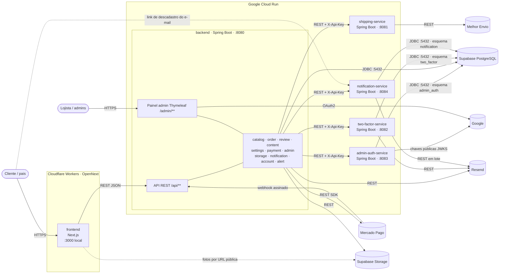

### Limites de cada serviço

| Serviço | Dono de | **Não** conhece |
|---|---|---|
| **frontend** | Apresentação, carrinho no navegador, rotas públicas em português | Preços "verdadeiros" (sempre vêm da API), segredos |
| **backend** | Regras da loja: catálogo, pedido, estoque, moderação, conteúdo, configurações, acesso; **política** de frete (toggle, frete grátis, caixa padrão) | Qual transportadora é usada e como a API dela funciona |
| **shipping-service** | Integração com a transportadora: autenticação, formato da API, timeout, normalização e ordenação das opções | Produtos, preços de venda, pedidos, toggle, frete grátis, banco de dados |
| **admin-auth-service** | Lista de e-mails de admin (tabela própria), conferência do ID token do Google, regra "ninguém remove a si mesmo", primeiro admin (`ADMIN_BOOTSTRAP_EMAIL`) | Sessão do navegador, telas do painel, produtos, pedidos |
| **two-factor-service** | Código de uso único: sorteio, HMAC, validade, limite de tentativas e de pedidos, e-mail com o código | Quem é a pessoa, por que o código foi pedido, sessão, telas |
| **notification-service** | Pedidos de aviso (e-mail + produto + tipo) com consentimento, envio dos avisos, intervalo mínimo entre avisos, descadastro | Catálogo (nome, preço e link vêm no evento), pedidos, newsletter |

Um não faz o trabalho do outro. Exemplo do frete:

- "Frete grátis acima de R$ X" é uma **regra da loja**, então fica no backend (domínio `settings`).
- "Como perguntar o preço ao Melhor Envio" é uma **questão técnica**, então fica no shipping-service.

Quando o cliente fecha o pedido, o backend calcula o frete de novo. Assim o preço nunca vem do navegador
(que poderia ser alterado por alguém mal-intencionado).

---

## 10. Dependências e fluxos de comunicação

### Entre serviços

| De → Para | Protocolo | Por quê | Se falhar |
|---|---|---|---|
| frontend → backend | REST/JSON (CORS) | Única fonte de verdade de preço, estoque e pedidos | Loja sem catálogo e sem checkout |
| backend → shipping-service | REST/JSON + `X-Api-Key` | Cotar frete (F05) e recotar ao fechar pedido | Só a cotação falha (HTTP 422 com mensagem amigável); o resto da loja segue no ar, e o lojista pode desligar o frete no painel para voltar ao "a combinar" |
| shipping-service → Melhor Envio | REST + Bearer token | Preço e prazo reais | `502` com mensagem amigável (timeout de 8 s) |
| backend → Mercado Pago | REST (SDK) | Criar preferência e consultar pagamento | Modo manual: o lojista confirma no painel |
| Mercado Pago → backend | Webhook assinado (`x-signature`) | Avisar mudança de pagamento | Reconsulta ao cliente voltar (`payment-sync`) |
| backend → Supabase | JDBC (Session pooler) | Persistência | Indisponibilidade da loja |
| backend → Google | OAuth2 / OIDC | Redirecionamento do login do painel | Painel inacessível; a loja segue no ar |
| backend → admin-auth-service | REST/JSON + `X-Api-Key` | Conferir o login Google, perguntar se o e-mail logado continua admin (resposta guardada por 30 s) e gerenciar a lista | Ninguém entra no painel (nunca libera na dúvida); a loja segue no ar. O aviso de pedido pago aos admins não é enviado |
| admin-auth-service → Google | HTTPS (JWKS) | Baixar as chaves públicas para conferir a assinatura do ID token | Login recusado (`401`) |
| backend → Supabase Storage | REST + chave secreta | Guardar e apagar as fotos de produto (bucket público `product-images`) | O upload falha com mensagem amigável no painel; o produto é salvo sem a foto nova |
| frontend → Supabase Storage | HTTPS (URL pública) | Exibir as fotos sem passar pelo Cloud Run | As fotos não carregam até o storage voltar; o resto da loja segue no ar |
| frontend → Supabase Auth | HTTPS (SDK no navegador) | Login do cliente com Google | Só o login falha; a compra sem cadastro segue |
| backend → Supabase Auth | REST (`GET /auth/v1/user`) | Conferir o token do cliente em "Meus pedidos" e ao fechar pedido | "Meus pedidos" responde `401`; o pedido é fechado sem cadastro |
| backend → Resend | REST + Bearer token | E-mails de pedido recebido, pago e enviado | Só o e-mail falha (vai para o log); o pedido segue normalmente |
| backend (newsletter) → Resend | REST + Bearer token (lote de até 100) | Enviar a newsletter, no máximo `NEWSLETTER_DAILY_LIMIT` por 24 h | O lote reservado é liberado e ninguém recebe duas vezes; o lojista continua o envio depois |
| backend → two-factor-service | REST/JSON + `X-Api-Key` | Depois do login do painel: pedir um código para o e-mail do admin e conferir o que ele digitou (finalidade `admin-login`) | Ninguém passa da tela do código (nunca libera na dúvida); a loja segue no ar. Sem `TWO_FACTOR_SERVICE_URL`, o painel pede só o login |
| two-factor-service → Resend | REST + Bearer token | Enviar o código | `503`; o desafio é apagado e nenhum código fica valendo |
| backend → notification-service | REST/JSON + `X-Api-Key` | Gravar o "avise-me" feito na ficha do jogo; depois do commit, publicar "entrou em promoção" / "voltou ao estoque" e apagar as inscrições de produto excluído | O "avise-me" responde 422 com mensagem amigável; a falha ao publicar só vai para o log. O que o lojista salvou no painel não é desfeito. Sem `NOTIFICATION_SERVICE_URL`, a loja não mostra o "avise-me" |
| notification-service → Resend | REST + Bearer token (lote de até 100) | Enviar os avisos | O lote conta como `failed` e ninguém é marcado como avisado; o evento pode ser repetido |
| navegador → notification-service | HTTPS, sem chave (token no link) | Página de descadastro do e-mail | A pessoa tenta de novo depois; o cabeçalho `List-Unsubscribe` aponta para a mesma rota |

### Fluxo P1 + P2: compra com frete e pagamento

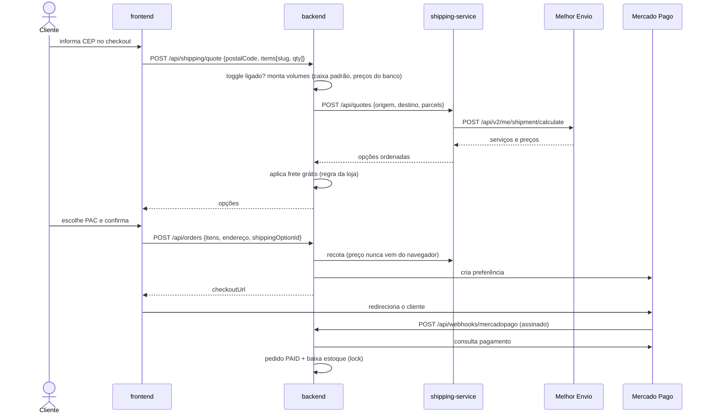

### Fluxo P4: moderação

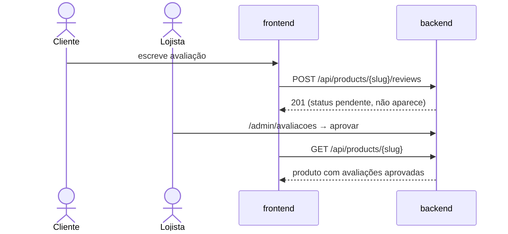

### Dependências internas do backend (entre módulos)

| Módulo | Depende de | Justificativa |
|---|---|---|
| order | catalog, payment, shipping | Pedido precisa de preço/estoque, cria cobrança e recota frete |
| payment | order | O gateway monta a preferência a partir do pedido; o webhook atualiza o pedido |
| shipping | catalog, settings | Monta os volumes com preço dos produtos e caixa padrão configurada |
| settings | shipping, admin | Só deixa ligar o frete se o provedor estiver configurado; registra qual admin alterou |
| catalog ⇄ review | — | A ficha do produto exibe avaliações aprovadas; a avaliação referencia o produto |
| content | admin | Registra qual admin editou |
| admin | catalog, order, review | Dashboard com contagens e métricas (faturamento, pedidos, mais vendidos, mais vistos) de cada domínio |
| catalog | storage | Guarda as fotos dos produtos e monta as URLs públicas |
| account | order | "Meus pedidos" lista os pedidos da conta; o `order` recebe a identidade do cliente ao fechar pedido |
| notification | order, admin | Escuta o evento `OrderEvent` e monta os e-mails; lê os e-mails dos admins para o aviso de pedido pago |

Ainda existem três pares de módulos que dependem um do outro nos dois sentidos: `catalog ⇄ review`,
`order ⇄ payment` e `settings ⇄ shipping`. Isso não é um problema hoje, porque todos estão dentro do mesmo
programa (o backend). Na separação do frete, o par `order ⇄ shipping` deixou de existir (a cotação ganhou um
DTO próprio) e o `GET /api/settings` foi para o domínio `settings`. Se algum desses domínios virar um serviço
separado um dia, a dependência teria que virar um evento (ex.: `PaymentApproved`) ou uma interface.

**Como os e-mails saem sem o pedido depender deles:**

1. O módulo `order` não chama o `notification` direto. Ele só "anuncia" um `OrderEvent` (`PLACED`, `PAID`,
   `SHIPPED`, `PAYMENT_REMINDER`), e o `notification` está "escutando".
2. Quando uma venda deixa um jogo no limite de estoque baixo, o `order` anuncia um `ProductEvent` `LOW_STOCK`.
   O `notification` avisa os admins e o `alert` repassa para o notification-service.
3. O e-mail é preparado junto com o pedido, mas só é enviado **depois que o pedido foi salvo no banco**
   (`EmailDispatcher`). O envio acontece antes de responder ao navegador, e não em segundo plano, porque o
   Cloud Run corta o processador assim que a resposta sai, e uma tarefa em segundo plano poderia nem rodar.

---

## 11. Modelo de dados por serviço

Cada serviço é dono exclusivo dos seus dados. Nenhum serviço lê ou grava as tabelas de outro.

### 11.1 backend: Supabase PostgreSQL (esquema `public`)

Esquema versionado pelo Flyway (`backend/src/main/resources/db/migration`). Cada tabela pertence a **um**
módulo de domínio, e só esse módulo tem o repositório JPA que a acessa.

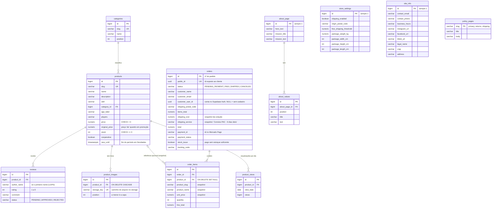

| Módulo (domínio) | Tabelas de que é dono | Entidades JPA |
|---|---|---|
| catalog | `categories`, `products`, `product_images`, `product_views` | `Category`, `Product`, `ProductImage`, `ProductView` |
| review | `reviews` | `Review` |
| newsletter | `newsletter_subscribers`, `newsletter_campaigns`, `newsletter_campaign_products`, `newsletter_deliveries` | `NewsletterSubscriber`, `NewsletterCampaign`, `NewsletterDelivery` |
| order | `orders`, `order_items` | `Order`, `OrderItem` (+ `Customer`, `Address` embutidos) |
| content | `about_page`, `about_values`, `policy_pages`, `site_info` | `AboutPage`, `AboutValue`, `PolicyPage`, `SiteInfo` |
| settings | `store_settings` | `StoreSettings` |
| admin | `spring_session`, `spring_session_attributes` | — (sessões via Spring Session JDBC; a lista de admins vem do admin-auth-service pela interface `AdminDirectory`) |
| payment | — (o estado do pagamento é gravado no pedido: `payment_*`) | — |
| shipping (adaptador) | — (o resultado vira snapshot no pedido: `shipping_cost`, `shipping_service`) | — |
| storage (adaptador) | — (os arquivos ficam no Supabase Storage; o `catalog` guarda só a chave) | — |
| notification (adaptador) | — (não guarda os e-mails enviados) | — |

Todas as tabelas usam `snake_case` no plural e datas `TIMESTAMP WITH TIME ZONE`. Valores em dinheiro são
`NUMERIC(10,2)`, nunca ponto flutuante.

### 11.2 shipping-service: sem banco

Este serviço não salva nada. As classes abaixo só descrevem o que entra e o que sai de cada chamada,
e cada cotação é calculada na hora pela transportadora.

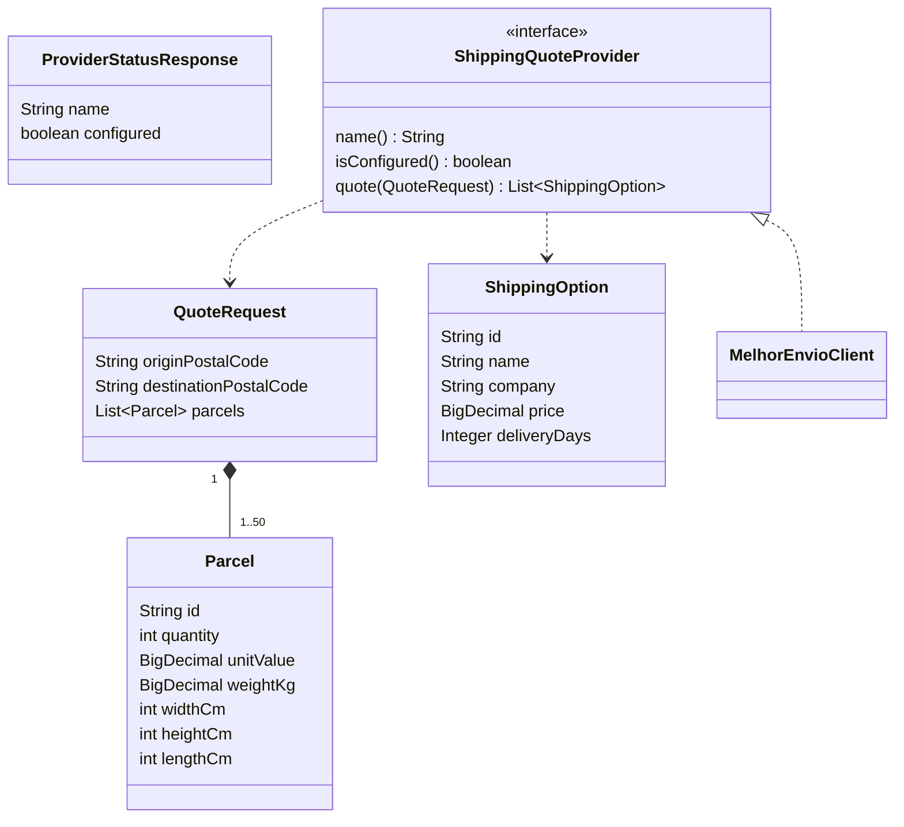

A única configuração do serviço (token, sandbox, chave de API) vem de variáveis de ambiente e
segredos do Cloud Run, e não de um banco.

### 11.3 admin-auth-service: Supabase PostgreSQL (esquema `admin_auth`)

Uma única tabela, versionada pelo Flyway do próprio serviço:

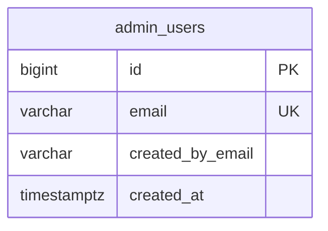

O e-mail é sempre guardado em minúsculas e sem espaços. Não há chave estrangeira para o banco do backend:
os campos `updated_by_email` das tabelas do backend guardam o e-mail como texto.

### 11.4 two-factor-service: Supabase PostgreSQL (esquema `two_factor`)

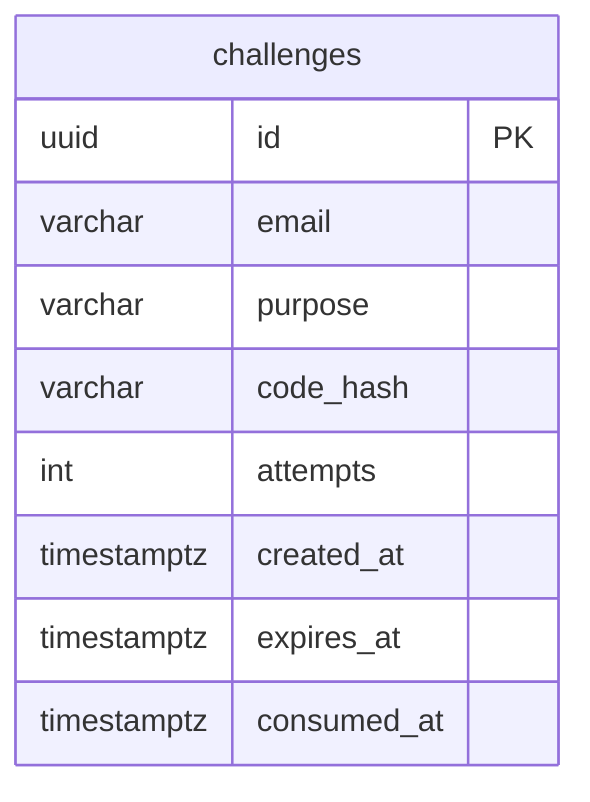

O código nunca é gravado: `code_hash` é o HMAC-SHA256 dele com uma chave que só o serviço tem
(`TWO_FACTOR_CODE_SECRET`). Linhas vencidas há mais de um dia são apagadas a cada novo pedido de código.

### 11.5 notification-service: Supabase PostgreSQL (esquema `notification`)

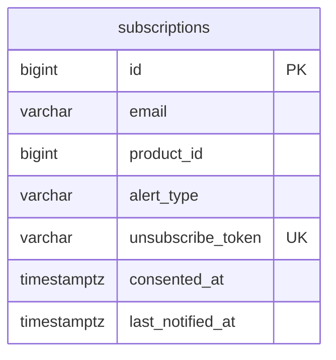

`(email, product_id, alert_type)` é único. `product_id` é o id do produto no backend, guardado como número
solto, sem chave estrangeira. `consented_at` é o registro do consentimento (LGPD); o descadastro apaga a linha.

---

## 12. Autonomia dos dados e bancos previstos

**Regra adotada: cada serviço tem o seu banco (*database per service*).** Se um serviço precisa de um dado
de outro, ele pede pela API do outro. Nunca lê direto o banco alheio.

| Serviço | Banco previsto | Quem acessa | Situação |
|---|---|---|---|
| backend | Supabase PostgreSQL (free, 500 MB), banco `postgres`, esquema `public`, via Session pooler :5432. Local: H2 em modo PostgreSQL | **Só o backend** (credenciais `DB_USER`/`DB_PASSWORD` só nele) | Em uso |
| shipping-service | **Nenhum.** Sem estado, tudo vem na requisição | — | Em uso |
| admin-auth-service | Mesmo projeto Supabase, esquema `admin_auth` (fora do `public`, não aparece no PostgREST), com usuário próprio. Local: H2 em modo PostgreSQL (`data/admin-auth`) | **Só o admin-auth-service** | Em uso |
| two-factor-service | Mesmo projeto Supabase, esquema `two_factor`, com usuário próprio. Local: H2 em modo PostgreSQL (`data/two-factor`) | **Só o two-factor-service** | Em uso local; falta criar o esquema e o usuário no Supabase |
| notification-service | Mesmo projeto Supabase, esquema `notification`, com usuário próprio. Local: H2 em modo PostgreSQL (`data/notification`) | **Só o notification-service** | Em uso local; falta criar o esquema e o usuário no Supabase |
| shipping-service (evolução) | Cache em memória das cotações (ex.: Caffeine, TTL de alguns minutos, chave = origem + destino + volumes) | Só o próprio serviço | Previsto, se a cota do Melhor Envio apertar |
| review-moderation-service (candidato) | Banco próprio: esquema `moderation` no mesmo projeto Supabase, com usuário próprio (sem acesso ao `public`) | Só ele | Previsto |
| recommendation-service (candidato) | Modelo de leitura próprio (projeção do catálogo: slug, idade, habilidade), atualizado pela API pública `GET /api/products` | Só ele | Previsto |

Como cada serviço fica independente:

- **O shipping-service não sabe o que é um jogo.** Ele recebe só um `id`, a quantidade, o valor e as medidas
  da caixa. Preço de venda, estoque e o botão de liga/desliga ficam no banco do backend.
- **O backend não guarda nada da transportadora.** Do frete, ele guarda só o que o cliente escolheu, como
  uma cópia no pedido (`shipping_cost`, `shipping_service`). Se a loja trocar o Melhor Envio por outro,
  os pedidos antigos continuam certos.
- **As senhas também são separadas.** O `MELHOR_ENVIO_TOKEN` só existe no shipping-service, e a senha do
  banco do backend só existe no backend. As únicas senhas que dois programas conhecem são as `X-Api-Key`
  (cada uma combinada entre o backend e um serviço).
- **A lista de admins não fica no banco do backend.** O backend pergunta ao admin-auth-service e guarda a
  resposta por 30 segundos. Quando alguém é removido pelo painel, essa memória é apagada na hora.
- **Todos os serviços usam o mesmo projeto do Supabase** (para continuar no plano grátis), mas cada um com o
  seu esquema e o seu usuário, que só tem permissão (`GRANT`) no próprio esquema. É como se fossem bancos
  separados, sem pagar por um segundo banco.
- **Dentro do backend**, cada tabela tem um único módulo dono (§11.1). Onde uma tabela aponta para a de outro
  módulo (`reviews → products`, `order_items → products`), seria preciso trocar por um id ou slug se o módulo
  virasse serviço. Em `order_items` isso já está pronto: o item guarda slug, nome e preço, e a ligação com
  `products` é opcional (se o jogo for apagado, ela fica vazia: `ON DELETE SET NULL`).

---

## 13. Relações entre serviços e estratégias de consistência

### 13.1 Relações

| Relação | Tipo | Dado que atravessa a fronteira | Fonte da verdade |
|---|---|---|---|
| backend → shipping-service | Síncrona, requisição/resposta, **somente leitura** | CEPs + volumes → opções com preço e prazo | Transportadora (Melhor Envio) |
| backend → Mercado Pago | Síncrona (criar preferência, consultar pagamento) | Pedido (itens, total, `external_reference` = `public_id`) | Mercado Pago, para o status do pagamento |
| Mercado Pago → backend | **Assíncrona** (webhook, pode repetir ou atrasar) | Só o `data.id` do pagamento | Mercado Pago (o backend sempre reconsulta) |
| frontend → backend | Síncrona REST | Catálogo, pedidos, avaliações | Backend |

### 13.2 Como os dados ficam certos em cada situação

| Situação | Estratégia | Como funciona |
|---|---|---|
| Pedido + estoque + pagamento (dentro do backend) | **Tudo junto numa transação** (consistência forte, ACID) | O `OrderService` usa `@Transactional`. Quando o pagamento é aprovado, o pedido vira `PAID` e o estoque baixa **na mesma transação**: ou as duas coisas acontecem, ou nenhuma. Enquanto isso, a linha do jogo fica travada (`findByIdForUpdate`, `PESSIMISTIC_WRITE`), para dois pedidos não mexerem nela ao mesmo tempo. |
| Aviso (webhook) do Mercado Pago | **Fica certo um pouco depois + pode repetir sem problema** (consistência eventual + idempotência) | O pedido começa como `PENDING_PAYMENT`. O aviso do Mercado Pago só traz um número, e o backend **pergunta de novo** ao Mercado Pago como está o pagamento. Se o pedido já estiver pago, `markPaid()` devolve `false` e nada muda; por isso avisos repetidos não baixam o estoque duas vezes. Se o pedido não existir, o backend responde 200 mesmo assim, para o Mercado Pago parar de reenviar. |
| Aviso do Mercado Pago atrasado ou perdido | **Conferir de novo quando o cliente volta** | Quando o cliente volta do pagamento, a loja chama `POST /api/orders/{id}/payment-sync`, que faz a mesma pergunta. Sem Mercado Pago configurado, o lojista usa o **modo manual** ("marcar como pago"). |
| Dois clientes comprando a última unidade | **Resolver depois** (compensação), em vez de reservar o jogo | O estoque é conferido ao criar o pedido, mas só baixa quando o pagamento é aprovado. Se os dois pagarem, o estoque vai a 0 e o segundo pedido fica marcado com `stock_issue = true`, com alerta no painel. O lojista resolve (devolve o dinheiro ou combina um prazo maior). Foi aceito assim porque a loja vende pouco e reservar unidades com prazo de validade seria bem mais complicado. |
| backend ↔ shipping-service | **Nada compartilhado + conferir de novo** | Calcular frete só lê, não muda nada; então dá para repetir quantas vezes quiser. O preço que aparece no checkout **não é confiável** (vem do navegador): ao fechar o pedido, o backend **calcula de novo** e usa o preço dele para a opção escolhida (`shippingOptionId`). Se a opção não existir mais, o pedido é recusado com uma mensagem clara (HTTP 422). |
| shipping-service fora do ar | **Falhar rápido, sem derrubar o resto** | O backend espera no máximo 15 s pelo serviço, e o serviço espera no máximo 8 s pelo Melhor Envio. Erro do lado deles (5xx) vira uma `BusinessException` (422) com mensagem amigável; erro do nosso lado (4xx, ex.: senha errada) vira uma mensagem genérica. Nenhum pedido é salvo sem um frete válido. |
| Jogo alterado depois da compra | **Cópia no pedido** (snapshot) | `order_items` copia `product_slug`, `product_name` e `unit_price`, e `orders` copia `shipping_cost` e `shipping_service`. Mudar o preço, apagar o jogo ou trocar de transportadora não muda os pedidos antigos. |
| Ligar o frete × serviço no ar | **Conferir antes de salvar** | Só dá para ligar o frete se `GET /api/provider` responder `configured: true`. Se o serviço cair depois, vale a linha "shipping-service fora do ar". |
| Criar pedido × Mercado Pago | **Tudo ou nada** | Se der erro ao criar o pagamento (`createCheckout`), a transação é desfeita e nenhum pedido "fantasma" fica salvo. |
| Login do painel com o Cloud Run rodando várias cópias | **Login salvo no banco** | A sessão fica no banco (Spring Session JDBC), então qualquer cópia do backend reconhece o admin. |

### 13.3 Se outros domínios virarem serviços um dia

Se pedido e estoque ficassem em serviços diferentes, não daria mais para salvar os dois numa transação só.
O plano para esse caso é uma **saga com *transactional outbox***, que funciona assim:

1. O `order` salva o pedido e, na mesma transação, salva uma mensagem `PaymentApproved` numa tabela `outbox`
   (uma "caixa de saída").
2. Um programa lê essa caixa de saída e entrega a mensagem (ex.: pelo Pub/Sub do Google, que tem plano grátis).
3. O `catalog` recebe a mensagem e baixa o estoque, sem repetir se a mesma mensagem chegar duas vezes (usa o
   número do pedido para saber). Se faltar estoque, ele manda `StockShortage` de volta, e o `order` marca o
   pedido com `stock_issue` (o mesmo que acontece hoje).

---

## 14. Endpoints e contratos das APIs REST

Regras que valem para todas as APIs:

- Os dados vão em JSON (UTF-8). Os nomes das rotas ficam no plural e com hífen (`/product-alerts`).
- Os erros seguem um formato padrão, o **RFC 9457** (`application/problem+json`). O campo `detail` já traz
  a mensagem pronta para mostrar ao usuário:

  ```json
  { "type": "about:blank", "title": "Unprocessable Entity", "status": 422,
    "detail": "\"Corrida dos Sapos\" esgotou. Remova do carrinho para continuar.", "instance": "/api/orders" }
  ```

  Erros de validação (400) trazem também `errors`, com a mensagem de cada campo:
  `{"status": 400, "detail": "Dados inválidos.", "errors": {"customer.email": "E-mail inválido."}}`.
- Dinheiro vai como número com 2 casas decimais (`89.90`). Datas vão no formato ISO-8601, no fuso UTC (`2026-10-01T03:00:00Z`).
- Códigos de resposta: `200` deu certo · `201` criado · `202` recebido, vai ser analisado · `400` dados errados ·
  `401` sem permissão · `404` não encontrado · `422` uma regra da loja impediu (ex.: jogo esgotado) ·
  `502`/`503` um sistema de fora falhou.

### 14.1 backend: API pública da loja (`/api/**`, CORS liberado só para `FRONTEND_ORIGINS`)

| Método e rota | Corpo / parâmetros | Resposta de sucesso | Erros |
|---|---|---|---|
| `GET /api/categories` | — | `200` `[{slug, name}]` | — |
| `GET /api/products` | query opcionais: `category` (slug), `cooperative`, `isNew`, `onSale` (booleanos) | `200` `[Product]` | — |
| `GET /api/products/{slug}` | — | `200` `Product` | `404` |
| `POST /api/products/{slug}/reviews` | `{name, rating (1–5), comment (≤1000)}` | `202` `{"status": "pending"}` | `400`, `404` |
| `POST /api/newsletter-subscriptions` | `{email}` | `204` (também quando o e-mail já estava inscrito) | `400` |
| `POST /api/products/{slug}/views` | — (a loja chama ao abrir a ficha; só soma um contador por dia) | `204` | `404` |
| `GET /api/content/about` | — | `200` `{heroText, values: [{icon, title, text}], missionEmoji, missionTitle, missionText}` | — |
| `GET /api/content/site-info` | — | `200` `{contactEmail, contactPhone, whatsappUrl, businessHours, instagramUrl, facebookUrl, tiktokUrl, legalName, cnpj, address}` (campo não preenchido vem `null`) | — |
| `GET /api/content/policies/{slug}` | `slug` = `privacy`, `returns` ou `shipping` | `200` `{slug, title, body, updatedAt}` | `404` |
| `GET /api/settings` | — | `200` `{shippingEnabled, freeShippingThreshold}` | — |
| `POST /api/shipping/quote` | `{postalCode, items: [{slug, quantity (1–20)}] (1–50)}` | `200` `[ShippingOption]` | `400`, `422` (frete desligado, CEP sem entrega, serviço fora) |
| `POST /api/orders` | `OrderRequest` (abaixo) | `201` `{orderId (uuid), number, total, checkoutUrl}` | `400`, `422` (esgotado, frete inválido), `502` (Mercado Pago) |
| `GET /api/orders/{orderId}` | `orderId` = uuid público | `200` `OrderStatus` | `404` |
| `GET /api/account/orders` | cabeçalho `Authorization: Bearer <token do Supabase Auth>` | `200` `[OrderStatus]`, do mais novo para o mais antigo | `401` |
| `POST /api/orders/{orderId}/payment-sync` | `{paymentId}` (só dígitos) | `200` `OrderStatus` | `400`, `404`, `422` (pagamento de outro pedido) |
| `POST /api/webhooks/mercadopago` | query `type`, `data.id`; cabeçalhos `x-signature`, `x-request-id` | `200` (sempre, inclusive se o evento for ignorado) | `401` (assinatura inválida) |
| `GET /api/health` | — | `200` `{"status": "ok"}` | — |

**`Product`**:

```json
{
  "slug": "corrida-dos-sapos", "name": "Corrida dos Sapos", "icon": "🐸",
  "images": [ "https://<id>.supabase.co/storage/v1/object/public/product-images/products/1/5f0c….jpg" ],
  "description": "…", "skill": "Coordenação motora",
  "ageKey": "4-6", "age": "4 a 6 anos", "players": "2 a 4 jogadores",
  "price": 79.90, "promo": { "originalPrice": 89.90 },
  "inStock": true, "lowStock": false, "cooperative": false,
  "newUntil": "2026-10-15T02:59:59Z", "isNew": true,
  "reviews": [ { "id": 7, "name": "Ana", "rating": 5, "comment": "Meu filho adora!" } ]
}
```

`promo` é `null` quando o produto não está em promoção. `reviews` traz **só as aprovadas**, e o estoque
exato não é exposto (apenas `inStock` e `lowStock`, "últimas unidades"). `images` são as URLs públicas das fotos, com a capa primeiro;
quando vem vazio, a loja mostra o emoji de `icon`.

**`OrderRequest`**:

```json
{
  "customer": { "name": "Maria Silva", "email": "maria@example.com", "phone": "(11) 98765-4321" },
  "shippingAddress": { "postalCode": "20040-002", "street": "Rua X", "number": "10", "complement": null,
                       "district": "Centro", "city": "Rio de Janeiro", "state": "RJ" },
  "items": [ { "slug": "corrida-dos-sapos", "quantity": 2 } ],
  "shippingOptionId": "1"
}
```

Os itens levam **só slug e quantidade**: preço, total e frete são calculados no servidor.
`shippingOptionId` é obrigatório apenas com o frete automático ligado. Se a requisição trouxer
`Authorization: Bearer <token>` de um cliente logado, o pedido fica ligado à conta dele.

**`ShippingOption`** (backend → loja):
`{"id": "1", "name": "PAC", "company": "Correios", "price": 0.00, "originalPrice": 25.50, "deliveryDays": 6}`.
`originalPrice` só aparece quando o frete grátis foi aplicado.

**`OrderStatus`**:

```json
{
  "orderId": "3f2c…", "number": 42, "status": "PAID", "statusLabel": "Pago — preparar envio",
  "items": [ { "slug": "corrida-dos-sapos", "name": "Corrida dos Sapos", "quantity": 2,
               "unitPrice": 79.90, "lineTotal": 159.80 } ],
  "itemsTotal": 159.80, "shippingCost": 0.00, "shippingService": "Correios PAC · 6 dias úteis",
  "total": 159.80, "trackingCode": null, "createdAt": "2026-09-28T14:03:00Z", "payable": false
}
```

Rotas ligadas aos dois serviços mais novos:

| Método e rota | Corpo / parâmetros | Resposta de sucesso | Erros |
|---|---|---|---|
| `POST /api/product-alerts` | `{email, productSlug, type, consent: true}`; `type` = `PROMOTION`, `BACK_IN_STOCK` ou `LOW_STOCK` | `204` (repetir o pedido não é erro) | `400` (inclusive sem consentimento) · `404` produto · `422` aviso sem sentido (jogo já disponível / já em promoção / já nas últimas unidades) ou serviço fora do ar |
| `POST /api/orders/{orderId}/checkouts` | — ("Pagar agora" do pedido que ficou sem pagar) | `201` `{checkoutUrl}` | `404` · `422` (não está aguardando pagamento, ou algum jogo esgotou) |
| `POST /api/jobs/payment-reminders` | cabeçalho `X-Job-Key` (Cloud Scheduler) | `200` `{sent}` | `401` chave errada · `404` sem `JOBS_API_KEY` |
| `GET /api/settings` | — | agora traz também `productAlertsEnabled` | — |

Fora de `/api/**` e `/admin/**`, o backend tem uma única página pública: `GET`/`POST /newsletter/descadastro/{token}`,
o link de descadastro da newsletter (o GET só pergunta; o POST apaga o e-mail e também atende o botão do
programa de e-mail, `List-Unsubscribe-Post`, por isso sem CSRF).

No painel, `GET`/`POST /admin/verificacao` e `POST /admin/verificacao/reenviar` são a tela do código do
two-factor-service; enquanto o código não é digitado, qualquer outra rota `/admin/**` redireciona para lá.

### 14.2 shipping-service: API interna (`/api/**` exige `X-Api-Key`)

| Método e rota | Corpo | Resposta de sucesso | Erros |
|---|---|---|---|
| `POST /api/quotes` | `QuoteRequest` (abaixo) | `200` `[{id, name, company, price, deliveryDays}]`, da mais barata para a mais cara | `400` validação · `401` chave · `502` transportadora falhou · `503` sem token |
| `GET /api/provider` | — | `200` `{"name": "melhor-envio", "configured": true}` | `401` |
| `GET /actuator/health` | — (sem chave) | `200` `{"status": "UP"}` | — |

```json
{
  "originPostalCode": "01310-100",
  "destinationPostalCode": "20040-002",
  "parcels": [
    { "id": "corrida-dos-sapos", "quantity": 2, "unitValue": 79.90,
      "weightKg": 1.0, "widthCm": 30, "heightCm": 8, "lengthCm": 30 }
  ]
}
```

Regras do contrato: CEP no formato `00000-000` ou `00000000`; 1 a 50 volumes; `quantity ≥ 1`;
`weightKg > 0`; medidas ≥ 1 cm. O `price` retornado é o preço cheio da transportadora, sem regra comercial;
o frete grátis é aplicado pelo backend.

**Versionamento e compatibilidade.** Os contratos são testados dos dois lados: `QuoteApiTests` no serviço e
`ShippingServiceClientTests` no backend. Campos novos só podem ser **adicionados** (o cliente ignora campos
desconhecidos, com `@JsonIgnoreProperties(ignoreUnknown = true)`). Uma mudança incompatível exige uma nova
rota (`/api/v2/quotes`), mantendo a antiga até o backend migrar.

### 14.3 admin-auth-service: API interna (`/api/**` exige `X-Api-Key`)

| Método e rota | Corpo / parâmetros | Resposta de sucesso | Erros |
|---|---|---|---|
| `POST /api/logins` | `{idToken}` (ID token do Google recebido pelo backend) | `200` `{email, admin: true}` | `401` token inválido · `403` e-mail não verificado ou fora da lista · `503` sem `GOOGLE_CLIENT_ID` |
| `GET /api/authorizations?email=` | — | `200` `{email, admin}` | — |
| `GET /api/admins` | — | `200` `[{id, email, createdByEmail, createdAt}]` | — |
| `POST /api/admins` | `{email, createdByEmail}` | `201` admin criado | `400`, `409` (já é admin) |
| `DELETE /api/admins/{id}?requestedBy=` | `requestedBy` = e-mail de quem está removendo | `204` | `404`, `409` (remover a si mesmo) |
| `GET /actuator/health` | — | `200` | — |

### 14.4 two-factor-service: API interna (`/api/**` exige `X-Api-Key`)

| Método e rota | Corpo / parâmetros | Resposta de sucesso | Erros |
|---|---|---|---|
| `POST /api/challenges` | `{email, purpose}` | `201` `{id, email, purpose, expiresAt}` (o código vai só no e-mail) | `400` · `429` muitos pedidos para o e-mail · `503` e-mail não enviado |
| `POST /api/challenges/{id}/verifications` | `{code}` (6 números) | `200` `{id, email, purpose, verified: true}` | `400` · `404` · `410` vencido, usado ou bloqueado · `422` código incorreto (`attemptsLeft`) |
| `GET /actuator/health` | — | `200` | — |

### 14.5 notification-service: API interna (`/api/**` exige `X-Api-Key`) e descadastro (aberto)

| Método e rota | Corpo / parâmetros | Resposta de sucesso | Erros |
|---|---|---|---|
| `POST /api/subscriptions` | `{email, productId, type, consent: true}`; `type` = `PROMOTION`, `BACK_IN_STOCK` ou `LOW_STOCK` | `201` nova · `200` já existia: `{id, email, productId, type, consentedAt, lastNotifiedAt}` | `400` (inclusive sem consentimento) |
| `GET /api/subscriptions?email=&productId=` | filtros opcionais | `200` lista | — |
| `DELETE /api/subscriptions/{id}` | — | `204` | `404` |
| `DELETE /api/subscriptions?email=` ou `?productId=` | exatamente um dos dois | `200` `{removed}` | `400` |
| `POST /api/product-events` | `{type, productId, productName, productUrl, price, originalPrice?, stock?}` | `200` `{subscribers, sent, failed, skipped}` | `400` |
| `GET /descadastro/{token}` | sem chave | `200` página de confirmação (não cancela nada) | — |
| `POST /descadastro/{token}` | sem chave; `all=true` cancela todos os avisos do e-mail | `200` página "aviso cancelado" | — |
| `GET /actuator/health` | — | `200` | — |

### 14.6 backend: painel admin (`/admin/**`)

Não é uma API REST: são páginas Thymeleaf renderizadas no servidor, com formulários HTML (`POST` + token
CSRF), protegidas por login Google e pelo e-mail conferido no admin-auth-service.

| Rota | Ações |
|---|---|
| `/admin` | Dashboard: contadores e métricas do período (`?periodo=7`, `30` ou `90` dias): faturamento, pedidos pagos, valor médio, visualizações, faturamento por dia, mais vendidos e mais vistos |
| `/admin/produtos` | listar, `novo`, `{id}/editar` (com envio de fotos, `multipart/form-data`), `{id}/fotos/{imageId}/capa`, `{id}/fotos/{imageId}/excluir`, `{id}/estoque`, `{id}/encerrar-promocao`, `{id}/excluir` |
| `/admin/categorias` | listar, criar, editar, excluir faixas etárias |
| `/admin/avaliacoes` | fila de moderação, `{id}/aprovar`, `{id}/rejeitar`, `{id}/excluir` |
| `/admin/newsletter` | newsletters e inscritos, `exportar` (CSV), `{id}/excluir`; `campanhas/nova`, `campanhas/{id}` (editar rascunho e prévia), `campanhas/{id}/teste`, `campanhas/{id}/envio` (começa ou continua), `campanhas/{id}/excluir`, `campanhas/promocoes` (rascunho com os jogos em promoção) |
| `/admin/pedidos` | listar/filtrar, `{id}`, `{id}/marcar-pago`, `{id}/marcar-enviado`, `{id}/cancelar` |
| `/admin/sobre` | editar a página Sobre |
| `/admin/politicas` | editar os textos de Privacidade, Trocas/Devoluções/Garantia e Frete |
| `/admin/contato` | editar e-mail, telefone/WhatsApp, horário, redes sociais, razão social, CNPJ e endereço |
| `/admin/configuracoes` | liga/desliga frete, CEP de origem, frete grátis, caixa padrão |
| `/admin/admins` | adicionar e remover administradores |

---

## 15. Fluxos de comunicação

Cada linha é uma conversa entre duas partes do sistema: quem chama quem, por qual rota e o que acontece se
der errado. A regra geral (§9): o navegador só fala com o backend, e só o backend fala com o
shipping-service, o Mercado Pago e o banco.

"Síncrono" quer dizer que quem chamou espera a resposta. "Assíncrono" quer dizer que o aviso chega depois,
quando o outro sistema quiser (como o webhook do Mercado Pago).

| # | Fluxo | Origem → destino | Estilo | Contrato | Em falha |
|---|---|---|---|---|---|
| C1 | Navegar no catálogo | frontend → backend | síncrono | `GET /api/products`, `/api/categories` | loja sem vitrine |
| C2 | Cotar frete | frontend → backend → shipping-service → Melhor Envio | síncrono em cadeia | `POST /api/shipping/quote` → `POST /api/quotes` | 422 amigável, resto da loja ok |
| C3 | Fechar pedido | frontend → backend (→ shipping-service, → Mercado Pago) | síncrono | `POST /api/orders` | nada é gravado (rollback) |
| C4 | Pagar | navegador → Mercado Pago | redirecionamento | `checkoutUrl` | cliente tenta de novo, pedido segue pendente |
| C5 | Confirmar pagamento | Mercado Pago → backend → Mercado Pago | **assíncrono** (webhook) + consulta | `POST /api/webhooks/mercadopago` | reenvio do Mercado Pago; C6 como reserva |
| C6 | Reconciliar pagamento | frontend → backend → Mercado Pago | síncrono | `POST /api/orders/{id}/payment-sync` | modo manual no painel |
| C7 | Enviar avaliação | frontend → backend | síncrono | `POST /api/products/{slug}/reviews` | cliente tenta de novo |
| C8 | Ligar frete no painel | painel → backend → shipping-service | síncrono | `GET /api/provider` | toggle travado, frete "a combinar" |
| C9 | Login do painel | navegador → Google → backend → admin-auth-service | OAuth2 redirect + síncrono | OIDC, depois `POST /api/logins` | painel inacessível, loja no ar |
| C11 | Conferir acesso a cada requisição do painel | backend → admin-auth-service | síncrono, com cache de 30 s | `GET /api/authorizations` | acesso negado até o serviço voltar |
| C12 | Contar visualização da ficha | frontend → backend | síncrono, sem esperar resposta | `POST /api/products/{slug}/views` | a visualização não é contada; a página não é afetada |
| C10 | Monitorar | Cloud Run → serviços | síncrono | `/actuator/health` | instância reiniciada |

Os fluxos C2, C3 e C5 estão detalhados no diagrama de sequência da §10. Os de falha e de configuração
estão abaixo.

### C2 em falha: transportadora fora do ar

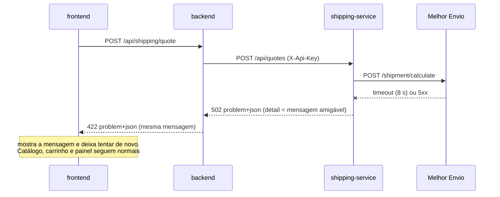

### C5 com notificação repetida (idempotência)

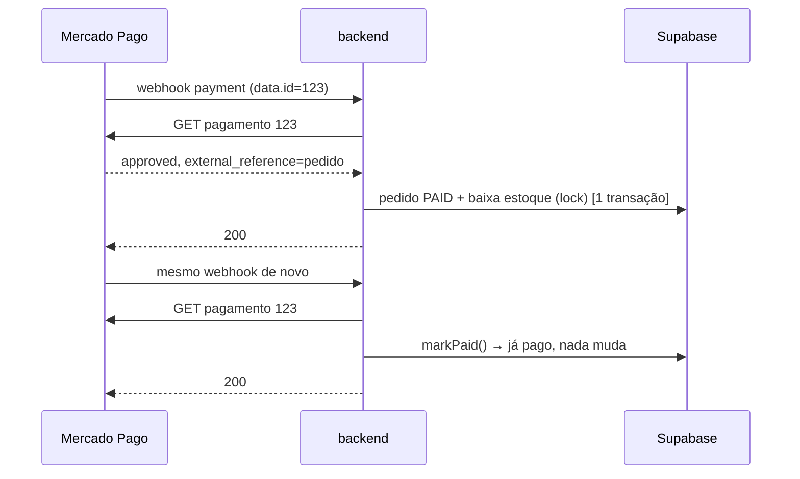

### C8: ligar o frete automático

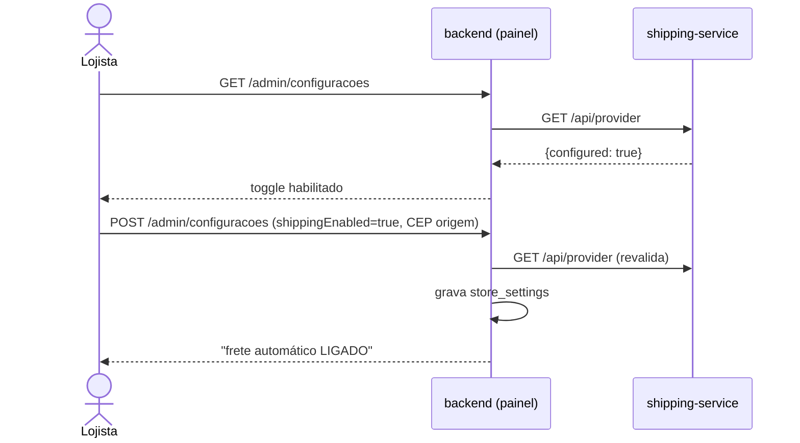

---

## 16. Portas

| Componente | Porta local | Produção | Exposição |
|---|---|---|---|
| frontend (Next.js) | **3000** | Cloudflare Workers (OpenNext), HTTPS 443 | Pública |
| backend (Spring Boot) | **8080** | Cloud Run, HTTPS 443 (`PORT` injetada) | Pública (`/api/**`), painel protegido por login |
| shipping-service (Spring Boot) | **8081** | Cloud Run, HTTPS 443 (`PORT` injetada) | Só o backend (`X-Api-Key`) |
| two-factor-service (Spring Boot) | **8082** | Cloud Run, HTTPS 443 (`PORT` injetada) | Só o backend (`X-Api-Key`) |
| admin-auth-service (Spring Boot) | **8083** | Cloud Run, HTTPS 443 (`PORT` injetada) | Só o backend (`X-Api-Key`) |
| notification-service (Spring Boot) | **8084** | Cloud Run, HTTPS 443 (`PORT` injetada) | API: só o backend (`X-Api-Key`). Página `/descadastro/{token}`: pública |
| H2 console (dev) | 8080 `/h2-console` | desligado | Local |
| Supabase PostgreSQL | — | 5432 (Session pooler, SSL) | O backend (esquema `public`), o admin-auth-service (`admin_auth`), o two-factor-service (`two_factor`) e o notification-service (`notification`), cada um com o seu usuário |

Para subir os cinco serviços Java juntos: `docker compose up --build` na raiz ([docker-compose.yml](../docker-compose.yml)).

Rotas e contratos de cada serviço: §14.

---

## 17. Justificativa da decomposição

Usando o frete como exemplo:

1. **Pelo negócio.** O frete é um problema *generic* com uma divisão clara: entra "origem + destino + caixas"
   e sai "opções com preço e prazo". Ele não precisa saber nada da loja, e a loja não precisa saber qual
   transportadora está por trás.
2. **Pela parte técnica.**
   - **Uma falha não derruba o resto:** o Melhor Envio é de fora e pode ficar lento. O tempo de espera e os
     erros ficam dentro do serviço, e o backend transforma qualquer falha numa mensagem amigável. Se o frete
     cair, só o cálculo do frete para; catálogo, painel e pagamentos continuam (RNF06).
   - **Segurança:** o token da transportadora não fica no backend, só no serviço, que é protegido por senha.
   - **Fácil de trocar:** usar outra transportadora é só criar outra classe que implementa
     `ShippingQuoteProvider` dentro do serviço, sem mexer no backend (RNF07).
   - **Custo:** o serviço não tem banco, desliga sozinho quando ninguém usa e não gasta conexões do Supabase (RNF01).
3. **Por que não separar mais.** Pedido, estoque e pagamento precisam ser salvos juntos (numa transação).
   Separar daria muito trabalho (sagas, filas, mais serviços, talvez pagos) sem vantagem para uma loja
   cuidada por uma pessoa só. Os outros domínios já estão em pastas separadas e podem virar serviços se um
   dia precisar (seção 8).
